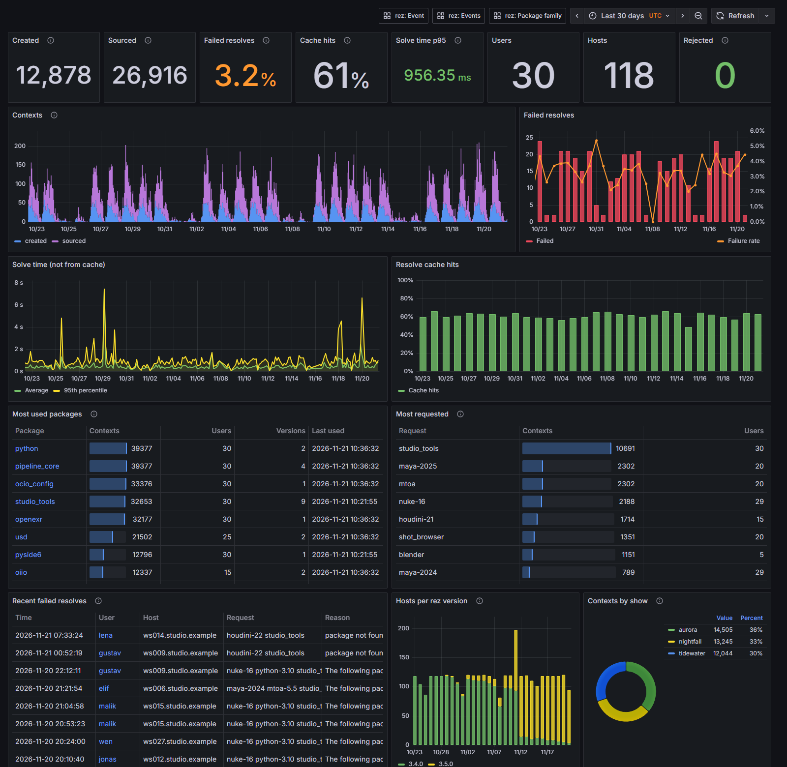
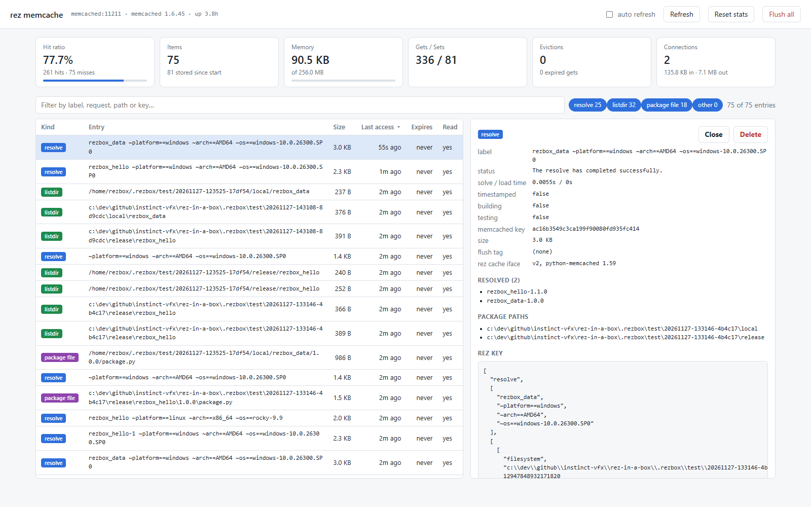

# rez in a box

A self-contained environment for evaluating and testing
[rez](https://github.com/AcademySoftwareFoundation/rez), including new rez
releases, together with the services rez integrates with:

- an **AMQP 0-9-1 broker** for context tracking and the `amqp` release hook
  (RabbitMQ by default, LavinMQ optional), including its web UI
- **context tracking storage**: the
  [rez-ctx-tracking-consumer](https://github.com/instinct-vfx/rez-ctx-tracking-consumer)
  stores every context event in **PostgreSQL**, and **Grafana** shows
  example dashboards (package adoption, failed resolves, resolve performance)
- **memcached** for resolve, listdir and package file caching, with a
  **rez-aware memcache inspector** (web UI and CLI)

> Status: phases 1-4 (services, inspector, rez installs, rezconfig, smoke
> test, events, Linux target) plus context tracking storage and dashboards.
> See [docs/PLAN.md](docs/PLAN.md) for decisions and per-phase findings, and
> [docs/DESIGN.md](docs/DESIGN.md) for how the non-obvious parts work.

## Requirements

- Docker with Compose v2 (Docker Desktop on Windows/macOS, running Linux containers)
- [uv](https://docs.astral.sh/uv/). The shims install it if it is missing.

## Quick start

```sh
./rezbox.sh up              # start services   (Windows: .\rezbox.ps1 up)
./rezbox.sh install-rez     # latest signed GitHub release, Python 3.11
./rezbox.sh test            # end-to-end check of rez against the services
./rezbox.sh shell           # shell with rez on PATH, configured for the box
```

This starts the services, waits until they are healthy, provisions the broker
and prints:

| Service | Address | Notes |
|---|---|---|
| Broker UI | http://127.0.0.1:15672 | login `admin` / `admin` |
| memcache inspector | http://127.0.0.1:8080 | |
| AMQP | `127.0.0.1:5672` | rez user `rez` / `rez`, exchange `rez` |
| memcached | `127.0.0.1:11211` | |
| Grafana | http://127.0.0.1:3000 | example dashboards; viewing needs no login |
| PostgreSQL | `127.0.0.1:5432` | database, user and password `rez` |
| consumer | http://127.0.0.1:9100 | `/healthz` and `/metrics` |

All ports are bound to `127.0.0.1` only. Inside the compose network the
broker is reachable as `amqp:5672` and memcached as `memcached:11211`.

The consumer is a published image
(`ghcr.io/instinct-vfx/rez-ctx-tracking-consumer`, a pinned version). If it
cannot be pulled, `up` says so and how to build or select another image
(`REZBOX_CONSUMER_IMAGE`) or to skip it (`up --no-tracking`).

## Context tracking storage and dashboards

Every `rez-env` (and every load of an `.rxt`) publishes a context tracking
message to the broker. The **consumer** reads them from the queue
`rez.context.tracking` and writes one row per event to PostgreSQL (table
`rez_context_event`, see the
[consumer's docs](https://github.com/instinct-vfx/rez-ctx-tracking-consumer)
for the schema and example queries). **Grafana** reads it through a read-only
role.

```sh
./rezbox.sh test                       # its events show up in the database
./rezbox.sh events context --history   # the last stored events (and rez.release)
./rezbox.sh seed-demo                  # 30 days of made-up events for the dashboards
```

Then open http://127.0.0.1:3000. [docs/dashboards.md](docs/dashboards.md)
describes the four dashboards and the demo data.



`up` starts both by default. `up --no-dashboards` leaves Grafana out,
`up --no-tracking` also leaves out PostgreSQL and the consumer (the choice is
remembered by later commands). With storage off, context messages are only
visible live (`events`) and `tracking-stored` is skipped in `rezbox test`.

The consumer connects with its own broker account (`rez-consumer`), which may
only use the exchange `rez` and its queue, not rez's publish-only account.
`psql` is available inside the container:
`docker compose -p rezbox exec postgres psql -U rez -d rez`.

`rezbox test-dashboards` checks every dashboard query against demo data in a
separate throwaway stack. Run it after changing a dashboard.

## Commands

| Command | Purpose |
|---|---|
| `up [--broker rabbitmq\|lavinmq] [--no-build] [--no-tracking] [--no-dashboards]` | start services, provision broker |
| `down [--volumes]` | stop services (`--volumes` also deletes broker and database data) |
| `status` | health, queue depths, consumer, stored events, memcached stats, URLs |
| `provision` | (re)create broker users, exchange, queues, bindings |
| `seed-demo [--days N] [--users N] [--seed N] [--delete]` | fill the tracking database with demo events (at most 100 days; demo rows have `DEMO.*` routing keys) |
| `test-dashboards [-v]` | run every dashboard query against demo data in a throwaway stack |
| `cache stats` | memcached statistics incl. hit ratio |
| `cache keys [--kind resolve\|listdir\|package_file\|other] [--json]` | list rez cache entries |
| `cache show <key>` | decode one entry |
| `cache flush`, `cache reset-stats` | |
| `reset [--all] [-y]` | stop services, delete broker and database data and box state (`--all`: also installs, Pythons, downloads) |
| `releases [--repo R]` | list GitHub releases and whether they are signed |
| `install-rez [--release TAG\|--git REF\|--path DIR] [--python 3.11\|3.12\|3.13]` | install rez, see below |
| `list-rez`, `use <label>`, `remove-rez <label>` | manage side-by-side installs |
| `shell [--rez LABEL] [-e K=V]` | interactive shell with rez on PATH |
| `run [--rez LABEL] [-e K=V] -- <cmd>` | run one command with rez on PATH |
| `env [--shell sh\|powershell]` | print the environment: `eval "$(./rezbox.sh env)"` or `.\rezbox.ps1 env \| Out-String \| iex` |
| `test [--rez LABEL\|--all] [--keep] [-v]` | end-to-end smoke test, see below |
| `events [all\|context\|release] [--history [N]] [--json]` | follow context tracking / release messages live, or show the last stored context events (database) and queued release messages |

## rez configuration

[config/rezconfig.py](config/rezconfig.py) is applied by `shell`, `run`, `env`
and `test` (through `REZ_CONFIG_FILE`). It reads `REZBOX_*` environment
variables, so the same file works on the host and in containers. It sets up:

- **memcached** (`memcached_uri`) for resolves, directory listings and package files
- **context tracking** to exchange `rez`, routing key `REZ.CONTEXT.<ACTION>`,
  with extra fields `rezbox_target`, `rezbox_platform`, `rezbox_install`
  (and `rezbox_run` during tests), and rez's default context fields plus
  `failure_description`
- the **amqp release hook** (`REZ.PACKAGE.RELEASED`) and git releases without
  an upstream (`allow_no_upstream`)
- **payload caching** into `.rezbox/package_cache/<platform>`, with
  `package_cache_same_device = True` (everything is on one disk, and without
  it rez skips caching) and `package_cache_local = True` (local packages are
  cached too)
- repositories `.rezbox/repos/local` and `.rezbox/repos/release`

| Toggle (1/0) | Default | Effect |
|---|---|---|
| `REZBOX_MEMCACHE` | 1 | memcached caching |
| `REZBOX_CONTEXT_TRACKING` | 1 | context tracking messages |
| `REZBOX_RELEASE_HOOK` | 1 | release messages |
| `REZBOX_PACKAGE_CACHE` | 1 | payload caching |
| `REZBOX_CACHE_LOCAL` | 1 | payload-cache local packages too |
| `REZBOX_CACHE_ASYNC` | 1 | cache payloads in the background |
| `REZBOX_DEFAULT_CACHABLE` | 0 | treat packages without `cachable` as cachable |

Paths: `REZBOX_LOCAL_PACKAGES`, `REZBOX_RELEASE_PACKAGES`,
`REZBOX_PACKAGE_CACHE_PATH`. For example, `./rezbox.sh shell -e REZBOX_CACHE_LOCAL=0`.

`package_cache_local` only governs *adding* local packages to the cache.
Payloads that are already cached are used whatever the setting.

### Shell profiles

`rezbox shell` starts your normal shell, so your PowerShell profile or
`~/.bashrc` runs too. If that sets `REZ_CONFIG_FILE` or other `REZ_*`
variables, or puts another rez on PATH, the box settings would be replaced.
`rezbox shell` therefore restores them after the profile has run, and says
which variables it reset.

Shells opened by `rez-env` inside the box run your profile *again*. rez's
PowerShell plugin starts them without `-NoProfile`, and `norc` is not
supported for PowerShell. rezbox cannot reach those shells, so make your
profile skip its rez setup inside the box. `REZBOX_ACTIVE` is set there and
inherited by every nested shell:

```powershell
if (-not $env:REZBOX_ACTIVE) {
    $env:REZ_CONFIG_FILE = "C:\path\to\your\rezconfig.py"
    # ... other REZ_* settings
}
```

```sh
if [ -z "${REZBOX_ACTIVE:-}" ]; then
    export REZ_CONFIG_FILE=~/rezconfig.py
fi
```

`rezbox run`, `rezbox test` and `rezbox env` do not load profiles, so they are
not affected. On Windows, `rezbox shell` also sets rez's `default_shell` to the
shell it started (pwsh if installed); rez otherwise defaults to Windows
PowerShell.

## Sample packages and smoke test

[packages/](packages/) holds two small cachable packages with a custom
(`build.py`) build: `rezbox_hello` (a Python module) and `rezbox_data` (a 4 MB
payload, requires `rezbox_hello-1`).

`rezbox test` releases and builds them in an isolated workdir
(`.rezbox/test/<run>`: its own repos and package cache, listening on a
temporary tap queue), so it does not touch your repos, caches or queues:

| Check | What it proves |
|---|---|
| config | rezconfig.py is in effect |
| release | `rez-release` from a git work copy works |
| release-hook | the amqp release hook message arrives |
| resolve | first resolve succeeds and is not from memcached |
| resolve-cached | the identical resolve comes from memcached (`get_hits` grows) |
| tracking | context tracking messages arrive, with the right `from_cache` flags |
| tracking-stored | the consumer stored them in PostgreSQL (skipped when storage is off) |
| payload-cache | the resolved environment points into the package cache |
| invalidation | releasing 1.1.0 invalidates the cached resolve |
| local-cache | a local package (`rez-build -i`) is payload-cached |
| local-no-cache | control: with `REZBOX_CACHE_LOCAL=0` it is not |

`--all` runs the test for every rez install on this platform. That's useful for
comparing a new release against the previous one. Logs and a `report.json`
are kept for failed runs (or with `--keep`).

## Linux target (containers)

Add `--target linux` to `install-rez`, `list-rez`, `use`, `remove-rez`,
`shell`, `run`, `test` or `env` to run it in a Linux container instead of on
the host:

```sh
./rezbox.sh install-rez --target linux                 # Rocky Linux 9 (default)
./rezbox.sh test --target linux
./rezbox.sh shell --target linux
./rezbox.sh run --target linux -- rez-env rezbox_hello -- env

./rezbox.sh install-rez --target linux --base-image ubuntu:24.04 --python 3.13
./rezbox.sh test --target linux --base-image ubuntu:24.04
```

The image ([docker/rez-linux](docker/rez-linux/Dockerfile)) is not a rez
image. It holds the base OS, git and uv, and runs this repo's `rezbox.py`
(mounted read-only). rez is installed inside it exactly as on the host:
GitHub release, sigstore verification, `install.py`, uv-managed Python. Any
base image with dnf, yum, apt-get or apk works. Images are built on first use
(`--rebuild-image` forces a rebuild) and tagged `rezbox/rez-linux:<base>`.

Each base image gets its own Docker volume `rezbox_home-<base>` for installs,
Pythons, repos, package cache and test workdirs. It lives on a Linux
filesystem (fast, and venv symlinks work), separate from the host's
`.rezbox`. The containers reach the services as `amqp` and `memcached` on the
compose network, and their messages are tagged `rezbox_target=linux`.
`reset --all` also removes these volumes; `down --volumes` never does.

Windows containers are not supported (see the plan): Docker Desktop runs
either Linux or Windows containers, not both, and the services are Linux
containers. Windows is covered by the host itself.

## Installing rez

rez is always installed with its own `install.py`, which gives a production
install (a pip install does not). It goes into a venv built from a
**uv-managed Python kept inside the box** (`.rezbox/python/<platform>`), so the
install depends on nothing outside the box.

| Source | Example | Trust |
|---|---|---|
| GitHub release (default) | `install-rez`, `install-rez --release 3.4.0` | sha256 checked against GitHub's asset digest; sigstore build-provenance attestation verified (3.4.0+) |
| Older release without assets | `install-rez --release 3.2.1` | GitHub tag tarball, unsigned |
| Git ref (also forks) | `install-rez --git main`, `install-rez --repo me/rez --git my-branch` | unsigned, pinned to the resolved commit |
| Local checkout | `install-rez --path ../rez --editable` | unsigned |

Release verification runs [sigstore-python](https://github.com/sigstore/sigstore-python)
through `uv tool run`, against the identity
`https://github.com/<repo>/.github/workflows/pypi.yaml@refs/tags/<tag>`. The
workflow path is read from the attestation; override it with
`REZBOX_REZ_RELEASE_WORKFLOW`. Archives and bundles that fail verification are
deleted, never reused. `--no-verify` skips the check, and `list-rez` then shows
the install as "NOT verified".

Installs are labelled `<tag>-py<X.Y>` by default and live side by side under
`.rezbox/rez/<platform>/`. Each has a `rezbox.json` recording its source,
digest, signing commit and Python version. `shell` and `run` drop `REZ_*`
variables from the calling environment, so a system rez setup cannot leak in;
pass overrides with `-e`. Set `GITHUB_TOKEN` if you hit GitHub API rate limits.

`REZBOX_HOME` relocates all box state (default `.rezbox` in the repo). It must
not contain spaces, because rez's `install.py` does not support them.

## Broker layout

rez only publishes and never declares the exchange, so `up` / `provision`
creates (idempotently, via the management HTTP API, so it works for RabbitMQ
and LavinMQ alike):

| Object | Details |
|---|---|
| user `rez` | write on exchange `rez`, read on `rez.*` queues |
| exchange `rez` | `topic`, durable, vhost `/` (rez has no vhost setting) |
| queue `rez.release` | bound `REZ.PACKAGE.#` (amqp release hook publishes `REZ.PACKAGE.RELEASED`), capped |
| user `rez-consumer` | configure/read only the exchange `rez` and its queue, write only that queue |
| queue `rez.context.tracking` | bound `REZ.CONTEXT.*` (context tracking publishes `REZ.CONTEXT.<ACTION>`); read by the consumer |

`rez.release` is capped (`x-max-length`, default 10000, oldest dropped). The
consumer declares its exchange and queue itself and fails when the queue
exists with other arguments, so `rez.context.tracking` is created exactly as
the consumer would (durable, no arguments, uncapped); it is removed again when
storage is switched off, so nothing piles up unread. Earlier boxes had a
capped `rez.context` queue that nothing consumed; `up` removes it.

## memcache inspector



rez stores memcached entries under md5-hashed keys, but every value carries
its real key: rez stores `(qualified_key, value)` tuples. The inspector uses
this to show what each entry actually is:

- **resolve**: the request, package paths, resolver status, resolved variants, solve/load time
- **listdir**: repository directory listings
- **package_file**: cached `package.py` / `package.yaml` contents

Values are decoded with a restricted unpickler. Only plain builtins are
reconstructed. Any other class or callable referenced by a pickle becomes an
inert placeholder and is never imported or called, so inspecting the cache
cannot execute code.

Known memcached behaviour the inspector works around: with the default
segmented LRU, items that were just read are moved in the background, and
`lru_crawler metadump` skips them while they move. The inspector merges
several dumps when the result is smaller than `curr_items`.

## Configuration

Environment variables (same names in `compose.yaml` and the tooling):

| Variable | Default |
|---|---|
| `REZBOX_BROKER` | `rabbitmq` |
| `REZBOX_TRACKING` / `REZBOX_DASHBOARDS` | `1` / `1` (set by `up --[no-]tracking`, `--[no-]dashboards`, remembered) |
| `REZBOX_AMQP_PORT` / `REZBOX_AMQP_UI_PORT` | `5672` / `15672` |
| `REZBOX_MEMCACHED_PORT` / `REZBOX_CACHE_UI_PORT` | `11211` / `8080` |
| `REZBOX_POSTGRES_PORT` / `REZBOX_CONSUMER_PORT` / `REZBOX_GRAFANA_PORT` | `5432` / `9100` / `3000` |
| `REZBOX_CONSUMER_IMAGE` | `ghcr.io/instinct-vfx/rez-ctx-tracking-consumer:0.1.0` |
| `REZBOX_CONSUMER_AMQP_USER` / `REZBOX_CONSUMER_AMQP_PASSWORD` | `rez-consumer` / `rez-consumer` |
| `REZBOX_GRAFANA_ADMIN_PASSWORD` | `admin` (editing; viewing needs no login) |
| `REZBOX_AMQP_ADMIN_USER` / `REZBOX_AMQP_ADMIN_PASSWORD` | `admin` / `admin` |
| `REZBOX_AMQP_USER` / `REZBOX_AMQP_PASSWORD` | `rez` / `rez` |
| `REZBOX_AMQP_EXCHANGE` | `rez` |
| `REZBOX_QUEUE_MAX_LENGTH` | `10000` |
| `REZBOX_MEMCACHED_MB` | `256` |
| `REZBOX_RABBITMQ_TAG` / `REZBOX_LAVINMQ_TAG` / `REZBOX_MEMCACHED_TAG` | `4.4-management-alpine` / `2.11` / `1.6-alpine` |
| `REZBOX_POSTGRES_TAG` / `REZBOX_GRAFANA_TAG` | `17` / `12.2.1` |

Changing the admin password with LavinMQ requires going through `rezbox up`,
because LavinMQ takes a password hash and `rezbox` computes it.

## License

Apache 2.0, see [LICENSE](LICENSE).
