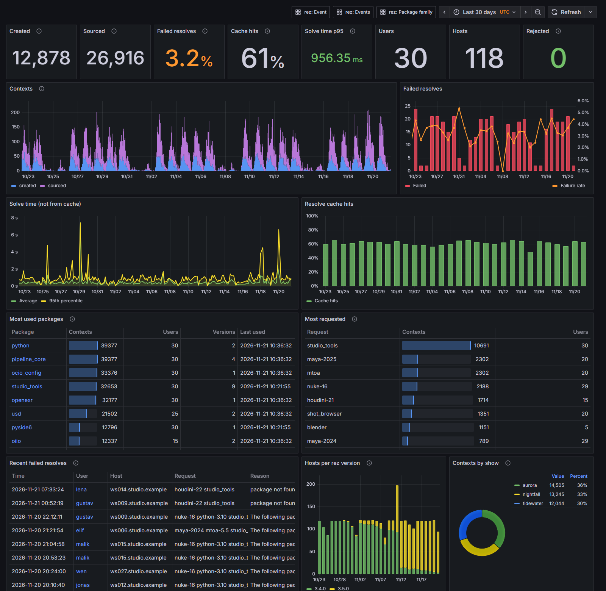
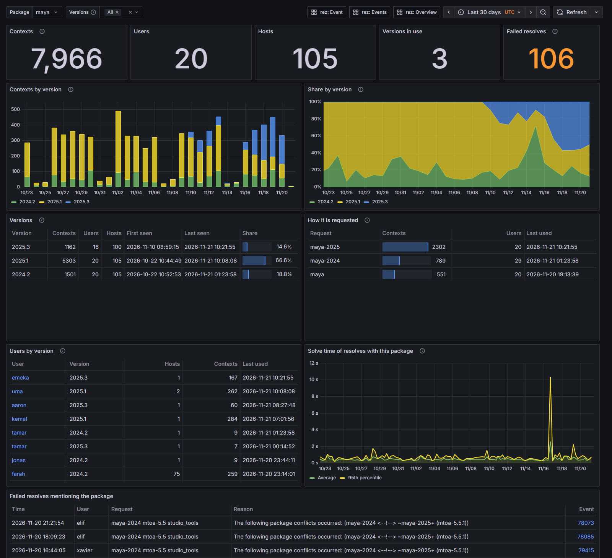
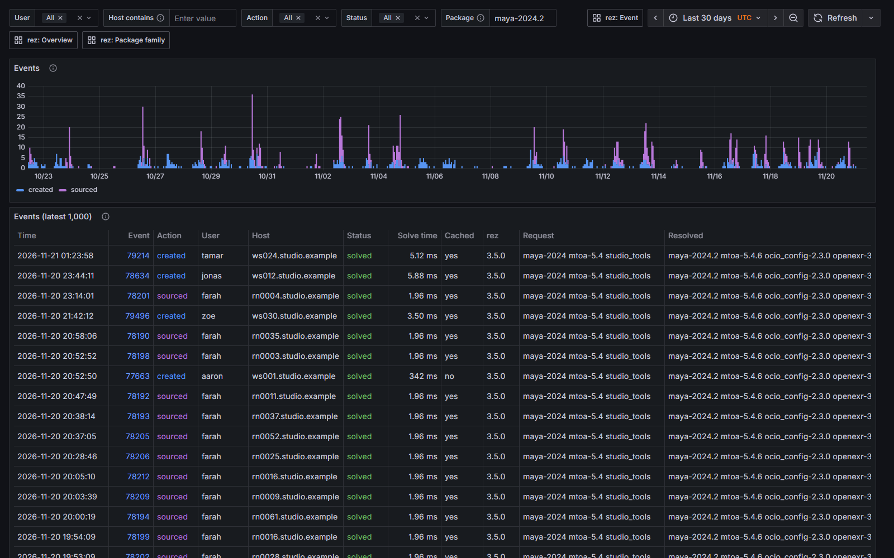
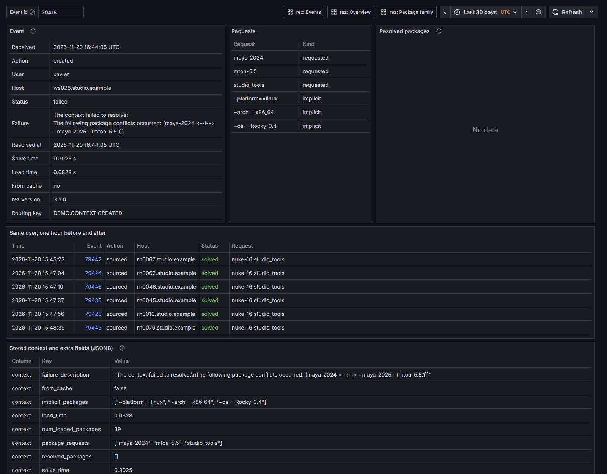

# Example dashboards

Four Grafana dashboards that show what the tracking data is good for: package
adoption, failed resolves, resolve performance, and the individual events
behind them. They are an example to start from, not a finished product; every
panel is plain SQL against `rez_context_event`, so they are easy to change.

- [Trying them out](#trying-them-out)
- [The dashboards](#the-dashboards)
- [Demo data](#demo-data)
- [Using your own Grafana](#using-your-own-grafana)
- [Changing the dashboards](#changing-the-dashboards)

## Trying them out

```sh
./rezbox.sh up             # Grafana is part of the default stack
./rezbox.sh seed-demo      # 30 days of made-up events
```

Then open <http://localhost:3000>. Viewing needs no login; to edit, log in as
`admin` / `admin` (`REZBOX_GRAFANA_ADMIN_PASSWORD`). Real events from
`./rezbox.sh test` or your own `rez-env` calls inside `./rezbox.sh shell`
appear next to the demo data. `rezbox down --volumes` stops everything and
deletes the data.

## The dashboards

All four are linked to each other: click a package, user or event id to open
the matching view, keeping the time range. Times are shown in UTC, like the
monthly partitions.

**Overview.** Created and sourced contexts, failure rate, resolve-cache hit
rate, solve times (95th percentile), the most used and most requested packages,
recent failed resolves with the reason, the rez rollout per host, and contexts
per show (an extra field).



**Package family.** Pick a package at the top. Contexts per version and each
version's share over time show how quickly a release is adopted. Below: users
and hosts per version, how the package is requested (explicit version requests
keep people on old versions), solve times, and failed resolves that mention it.



**Events.** The individual events, with filters for user, host, action, status
and package (a family like `maya` or an exact version like `maya-2025.3`).



**Event.** One event in detail: who, where, status and failure reason, the
requests, the resolved packages with their repositories, what the same user did
an hour before and after, and everything stored in `context` and `extra`.



Some panels need fields that rez doesn't send by default: the failure reason
needs `failure_description` in `context_tracking_context_fields` (the box's
[rezconfig.py](../config/rezconfig.py) sets it), and the "Contexts by show"
panel needs `context_tracking_extra_fields = {"show": "${SHOW}"}` (not set by
the box; the demo data has it). Without them those panels are empty or show
`(not set)`.

## Demo data

`rezbox seed-demo` generates plausible events and writes them straight to the
box's database. It runs [services/demo-seeder](../services/demo-seeder) inside
the consumer image:

- 30 artists in different roles (animation, lighting, FX, comp, TDs) on
  workstations in two sites, working mostly in office hours on weekdays;
- render farm jobs loading the artists' saved contexts (`sourced` events);
- package releases during the period, adopted by some artists within days and
  by others weeks later, and some who request older versions explicitly;
- rez being upgraded from 3.4.0 to 3.5.0 host by host;
- about 3% failed resolves (conflicts, typos, versions that don't exist), a
  60% resolve-cache hit rate, and occasional slow solves;
- `show` and `site` as extra fields, and `failure_description` and
  `num_loaded_packages` in the context.

Options: `--days` (default 30, at most 100), `--users` (default 30), `--seed`
for different random data. The default 30 days come to about 40,000 events and
take a few seconds.

The events go directly into Postgres, through the consumer's own parser and
insert code, because the consumer stamps each message from the broker with the
time it arrives. Demo rows have routing keys starting with `DEMO.`:

- running `seed-demo` again replaces the previous demo data;
- `seed-demo --delete` removes it;
- the box's database is for trying things out, so `rezbox seed-demo` always
  adds demo data next to real events (the seeder itself refuses that without
  `--force`; use a separate database when you do not want to mix).

Because the seeder uses the consumer's internal Python API, the box pins an
exact consumer version (`REZBOX_CONSUMER_IMAGE`). Its generator has unit tests:
[tests/test_demo_seeder.py](../tests/test_demo_seeder.py).

## Using your own Grafana

The dashboards work with any Grafana that can reach the consumer's database
(tested with Grafana 12.2).

1. Create a read-only role for Grafana. With the schema layout from the
   [consumer's operations guide](https://github.com/instinct-vfx/rez-ctx-tracking-consumer/blob/main/docs/operations.md):

   ```sql
   CREATE ROLE grafana_reader LOGIN PASSWORD 'secret';
   ALTER ROLE grafana_reader SET statement_timeout = '30s';
   GRANT USAGE ON SCHEMA rez_tracking TO grafana_reader;
   GRANT SELECT ON rez_tracking.rez_context_event, rez_tracking.rez_context_event_reject
       TO grafana_reader;
   ALTER ROLE grafana_reader SET search_path = rez_tracking;
   ```

   The statement timeout keeps an expensive ad-hoc query from running forever.
   [services/grafana/reader-role.sql](../services/grafana/reader-role.sql) is
   what the box runs.

2. Add a PostgreSQL data source with the UID `rez-postgres`; the dashboards
   refer to it by that UID. Grafana's UI doesn't let you choose a UID, so copy
   [services/grafana/provisioning/datasources/rez.yaml](../services/grafana/provisioning/datasources/rez.yaml)
   into Grafana's provisioning directory and fill in the values (or create the
   data source through the HTTP API). To use an existing data source instead,
   replace `rez-postgres` in the JSON files with its UID.

3. Import the files in
   [services/grafana/dashboards/](../services/grafana/dashboards/) (Dashboards >
   New > Import), or provision them like
   [services/grafana/provisioning/dashboards/rez.yaml](../services/grafana/provisioning/dashboards/rez.yaml)
   does. Keep the UIDs (`rez-overview`, `rez-package-family`, `rez-events`,
   `rez-event`): the links between the dashboards use them.

## Changing the dashboards

The box provisions the dashboards from files, so Grafana won't save
changes over them. Edit a panel, then either use "Save as" for a copy, or
export the dashboard as JSON (Share > Export) and replace the file in
`services/grafana/dashboards/`. Grafana picks up changed files within about
ten seconds.

Patterns used in the queries, useful for new panels:

- `$__timeFilter(received_at)` limits a query to the selected time range. Every
  query should have it: the table is partitioned by month on `received_at`, so
  Postgres only reads the partitions in range.
- `$__timeGroupAlias(received_at, $__interval, 0)` buckets events for charts. The
  panel's "Min interval" (1h, 1d) sets the bucket size; the `0` fills empty
  buckets with zero. A `metric` column splits the result into one series per
  value, e.g. per action or per version.
- `split_part(pkg, '-', 1)` is the package family of a `resolved_packages`
  entry, and `substr(pkg, length(family) + 2)` its version.
- Multi-value variables with "All" use `'__all__'` as the "All" value, and the
  queries check `('__all__' IN ($user) OR username IN ($user))`. That keeps the
  query short when "All" is selected, however many users there are.
- Text box variables are quoted by Grafana for SQL (`'$host'`). The event id is
  turned into a number with `substring('$id' FROM '^[0-9]{1,18}$')::bigint`, so
  anything else finds nothing instead of causing an error.

Filtering by package family (rather than an exact `name-version`) can't use the
GIN index on `resolved_packages`, so it reads all rows in the time range. That
is fine for months of data at studio scale; for very large tables, narrow the
time range.

`rezbox test-dashboards` runs every query of every panel through Grafana
against demo data, in a separate throwaway stack. Run it after changing the
dashboards.
